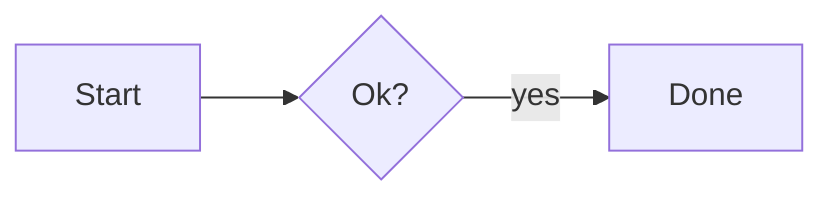

# Slate Markdown Editor Components — 0.19.5

This project is the reusable Slate Markdown editor extracted from the current Wire integration.

The functional editor remains deliberately simple to reuse: **all editor markup, navigation, formatting controls, modes, outline logic, Markdown rendering, checklist logic, media handling, persistence and public API live in `slate.js`**. A host application only needs `slate.js` and `slate.css`.

Edit and Source are one [CodeMirror 6](https://codemirror.net/) editor: Source shows the raw Markdown, Edit draws it in place (Live Preview). Preview is Slate's own read-only rendering. `slate.js` is built from `src/` with CodeMirror bundled in, so hosts still load one script and one stylesheet with no other dependency (see **Building** below).

## What is included

- `slate.js` — complete Slate 0.19.5 editor/component, built from `src/` (don't edit it by hand).
- `src/slate.js` — the editor source; `src/source-editor.js` — the CodeMirror editor behind Edit and Source; `src/live-preview.js` — Edit mode's Live Preview drawing; `src/changes.js` — the block and word comparison behind Show Changes; `src/forms.js` — form templates: fields, answer checks and fill mode's text.
- `slate.css` — generic scoped component styling.
- `mermaid/` — [Mermaid](https://mermaid.js.org/) for diagrams, built from `src/mermaid-entry.js`: `mermaid.js` plus a chunk per diagram type. Hosts copy the folder next to `slate.js`; it is loaded only when a document has a diagram (see **Diagrams**).
- `themes/bartco.css` — the current Wire/Bartco light-theme overrides, kept separately so the component can be reused elsewhere without forcing Bartco branding.
- `slate-editor.d.ts` — TypeScript declarations for the host API.
- `index.html` — standalone persistent editor using the Bartco theme.
- `examples/host-controlled.html` — embed Slate in another application while the host owns the Markdown.
- `examples/read-only-checklist.html` — read-only instructions with interactive task checkboxes, matching Wire's published-instructions use case.
- `examples/attachment-handler.html` — host attachment callback example.
- `docs/attachment-api.md` — attachment callback contract.

## Building

`slate.js` is generated. Edit the files in `src/`, then rebuild (Node.js 20 or newer):

```powershell
npm install
npm run build        # minified slate.js and mermaid/, as committed and shipped
npm run build:dev    # readable slate.js with an inline source map, for debugging
npm run watch        # rebuild on every change while developing
```

Commit the rebuilt `slate.js` (and `mermaid/` when Mermaid changes) with the source change, so hosts can keep copying the files.
`npm run build:slate` and `npm run build:mermaid` build one of them.

## Run the standalone editor

The simplest option is:

```powershell
python -m http.server 8080
```

Then open `http://localhost:8080/`.

On Windows you can also run:

```powershell
.\start_slate_editor.bat
```

The standalone page uses Slate's local IndexedDB document and attachment storage.

## Minimal host integration

```html
<link rel="stylesheet" href="slate.css">
<div id="assemblyInstructions" style="height:680px"></div>
<script src="slate.js"></script>
<script>
(async () => {
  const host = document.querySelector('#assemblyInstructions');

  const editor = await window.SlateMarkdownEditor.mount(host, {
    markdown: '# Assembly instructions\n\n- [ ] Fit bracket\n',
    persist: false,
    persistSettings: false,
    workspaceMode: 'edit',
    showReadyToast: false,
  });

  host.addEventListener('slate:change', event => {
    saveIntoApplication(event.detail.markdown);
  });
})();
</script>
```

Slate adds `.slate-editor-host` to the supplied host element. All component styles are scoped below that class, so Slate can live directly inside another application without an iframe.

## Optional Bartco/Wire theme

Load the theme after the base stylesheet:

```html
<link rel="stylesheet" href="slate.css">
<link rel="stylesheet" href="themes/bartco.css">
```

The optional theme contains the green/gold document styling currently used by Wire. Removing it leaves Slate's original neutral/purple component theme intact.

## Mount options

```javascript
const editor = await window.SlateMarkdownEditor.mount(host, {
  markdown: initialMarkdown,
  persist: false,
  persistSettings: false,
  workspaceMode: 'edit',        // edit | preview | source
  outlineOpen: true,
  readOnly: false,
  interactiveTasks: false,
  theme: 'auto',                // auto | light | dark | paper
  showReadyToast: false,
  attachmentHandler: null,
  resolveUrl: null,
  outlinePanel: true,
  diagramsUrl: '',              // where mermaid/mermaid.js is; default: next to slate.js
});
```

### Diagrams and `diagramsUrl`

A fenced code block tagged `mermaid` is drawn as a diagram in Preview and Edit (flowcharts, sequence, state, class and Gantt diagrams, mind maps, pie charts and the rest of [Mermaid](https://mermaid.js.org/)):

````markdown

````

Mermaid is large, so it isn't in `slate.js`. The first diagram in a page loads `mermaid/mermaid.js` (an ES module) from the folder `slate.js` was loaded from, and that loads only the chunks its diagram types need (a flowchart is about 2.3 MB, read once). Pass `diagramsUrl` with the full URL of `mermaid.js` if it lives elsewhere. Until it loads, or if it can't, the block shows its source. A diagram with a mistake shows Mermaid's message above its source.

In Edit a diagram is a block like a table: clicking it, or its ✎ button, shows the source with the diagram drawn underneath as you type. Diagrams follow the host's theme (`data-theme` on the host: light, dark or paper). Mermaid runs with `securityLevel: 'strict'`, so diagram text can't run script or load anything.

### `outlinePanel`

`true` (default) shows Slate's own document navigation panel and its gutter button. Set it to `false` when the host draws the outline itself: the panel and gutter are hidden, and the host builds its own from `getOutline()` and the `slate:outline` event, calling `revealLine(line)` when a heading is clicked. `outlineOpen`, `setOutlineOpen()` and Ctrl+Shift+O still track whether the outline should be shown, and `slate:outline-toggle` reports changes.

### `resolveUrl`

Optional `(url, { kind }) => string`, where `kind` is `image` or `link`. Slate calls it when rendering an image `src` or link `href`, so a host can map relative paths (for example `img/a.png`) to something its page can load, such as a desktop app's file URL for the document's folder. The Markdown keeps the original URL; the rendered element carries it in `data-md-url`. Return a falsy value to leave a URL unchanged. `attachment://` URLs are never passed to it.

Web links (`http://`, `https://`) get a small ↗ after them. Bare addresses (`https://example.com`, `www.example.com`) and `<https://…>` are links too, as on GitHub. In Edit a plain click on a link's text (in the text or in a table) places the cursor there to edit it and Ctrl+click opens it; a plain click on the ↗ (class `slate-external-icon`, carrying `data-md-url`) opens it. Hosts that route links themselves can catch clicks on that class too.

### `persist`

- `true` (default): the document is stored in Slate's IndexedDB.
- `false`: the host application owns the Markdown.

### `persistSettings`

Controls Slate UI settings such as mode and outline state. It defaults to the value of `persist`.

### `workspaceMode`

- `edit` — Obsidian-style Live Preview: the Markdown drawn in place (headings, emphasis, links, lists, task checkboxes, quotes, code, tables, images and videos), with the syntax shown only where the cursor is. Tables, images and videos open as source when the cursor reaches them (or by clicking a table cell or a media block's ✎ button). Enter continues lists, tasks and quotes.
- `preview` — rendered document.
- `source` — the complete Markdown in a CodeMirror editor (syntax colouring, undo/redo with Ctrl+Z / Ctrl+Y, Tab indents).

### `readOnly`

`readOnly: true` hides editing controls and forces Preview.

### `interactiveTasks`

When enabled, ordinary `[ ]` / `[x]` task checkboxes remain interactive even in Preview/read-only mode. This is useful for assembly instructions, QA sheets, work travellers and other operational checklists.

Locked `[>]` video tasks are not directly clickable and complete only through supported playback completion.

## Public API

`mount()` returns the editor instance:

```javascript
const editor = await window.SlateMarkdownEditor.mount(host, options);
```

Available properties and methods:

```text
version
host
documentComplete
getMarkdown()
setMarkdown(markdown)
getWorkspaceMode()
setWorkspaceMode('edit' | 'preview' | 'source')
setReadOnly(boolean)
setInteractiveTasks(boolean)
setAttachmentHandler(handler | null)
isOutlineOpen()
setOutlineOpen(boolean)
getOutline()            // { headings: [{ id, level, line, title, checked, total, children }], completion }
revealLine(line)        // scroll to (or, in Source, select) a zero-based Markdown line
getTopLine()            // zero-based Markdown line at the top of the view, in any mode
selectSourceRange(start, end?, { focus? })  // Edit and Source: select offsets into getMarkdown() and scroll them to the middle
getSourceSelection()    // [start, end] of the cursor or selection, offsets into getMarkdown() (kept in Preview too)
restoreView({ selection?, topLine?, focus? })  // put a saved place back: the selection without scrolling, then topLine at the top, in any mode
setSourceHighlights(ranges, current?)       // Edit and Source: highlight [start, end) find matches; [] clears
compare(markdown, { label? })  // show another version inline (see Compare below); resolves to { comparing, label, differences }
endCompare()            // end it, keeping the document as it stands; returns what was left
isComparing()
getCompareState()       // { comparing, label, differences }
showChanges(markdown, { label?, to?, toLabel? })  // show what changed since another version, read only (see Show Changes below)
hideChanges()           // back to the document; returns what was shown
isShowingChanges()
getChangesState()       // { showing, label, toLabel, changes }
setChangesToggle(handler | null)  // a "± Changes" toolbar toggle; on calls handler, which calls showChanges()
isDocumentComplete()
getCompletionState()
onDocumentComplete(callback, options?)
focus()
```

The initial global `window.SlateMarkdownEditor` facade also exposes `mount()`, `ready`, and `setAttachmentHandler()`.

`setMarkdown()` replaces the text through the smallest change, so in Edit and Source the cursor and scroll position stay where they were when a host reloads a file that changed on disk. It also clears the undo history, since the new text is a fresh starting point.

### Compare

`compare(markdown, { label })` shows another version of the document inline, using CodeMirror's merge view. It is meant for a host resolving a sync conflict or a file that changed on disk while it was being edited:

```javascript
await editor.compare(textOnServer, { label: 'Space version' });
```

Slate switches to Source and shows a bar with the two colours, how many differences are left, **Use all of {label}** and **Done**. Text only in the other version is red, text only in this document green, and each difference has **Keep this** and **Use {label}** buttons. The document itself is what gets edited, so `slate:change`, saving and undo work as usual; the other version is never changed. Done returns to the mode the user was in. The comparison also ends on `endCompare()`, `setMarkdown()`, a mode change or `setReadOnly(true)`, each firing `slate:compare-end`. `compare()` rejects while the editor is read only.

### Show Changes

`showChanges(markdown, { label })` is for readers: it shows, read only and in place of the document, what changed since another version. Unlike Compare it has no buttons and works while the editor is read only:

```javascript
await editor.showChanges(previousVersion, { label: 'version 2' });       // "Changes since version 2"
await editor.showChanges(v1, { label: 'version 1', to: v2, toLabel: 'version 2' }); // two other versions
```

In **Preview** the rendered document is shown with removed words struck through in red and added words in green. A paragraph, heading, list item, quote, table or code block that was edited is drawn once with its changed words marked (and a yellow bar beside it); one that was added or removed outright is marked whole, green or red. Images, videos and diagrams that changed show as removed and added. In **Edit** and **Source** the Markdown is shown the same way, with CodeMirror's merge view. A bar names the versions, counts the changes, steps through them with ↑ and ↓, and has **Hide Changes**. The document is never changed. Switching mode keeps the changes showing; Hide Changes, `hideChanges()` or `compare()` end it, firing `slate:changes-end`. With no `to`, `setMarkdown()` redraws the changes against the new text.

Slate doesn't keep versions, so the host decides what to compare with. `setChangesToggle(handler)` adds a **± Changes** toggle to the toolbar; turning it on calls `handler`, which fetches the version it wants and calls `showChanges()`, and turning it off hides the changes. While the editor is read only the toolbar shows just this toggle, so readers can use it. `setChangesToggle(null)` removes it.

### Forms (fill mode)

A form template is a Markdown document whose front matter has `form`, `title` and `submitTo`, with fields as `{{type name=… …}}` tokens: `text`, `textarea`, `number`, `date`, `time`, `email`, `phone`, `choice` (with `multi` for several), `select`, `yesno` and `sign`. A choice or select takes its options from the list right below it. Metatrash 0.49.0 checks and files submissions; its `docs/forms.md` describes the syntax in full, and `src/forms.js` here parses it the same way.

```javascript
if (editor.isForm()) {
  await editor.startFill({ answers: savedDraft });        // inputs in place of the tokens
}
host.addEventListener('slate:form-input', e => saveDraft(e.detail.answers));
host.addEventListener('slate:form-submit', async e => {   // Send passed Slate's checks
  editor.setFormStatus('Sending…', { busy: true });
  const result = await send(e.detail.answers);
  if (result.fields) editor.setFormProblems(result.fields);    // the server's, by field
  else editor.setFormStatus('Sent', { kind: 'done' });
});
```

Fill mode draws the form as Preview does, in place of the document, with a real input for each field (radio buttons or check boxes under a choice, a drop-down for select, a box to tick for a signature) and the template's `<!-- comments -->` shown as hints: they are notes for the person filling it in, hidden everywhere else in Preview. Tokens in code stay text. **Send** checks every answer (required, lengths, patterns, number and date ranges, options) and shows each problem under its field; when they pass it fires `slate:form-submit`, and the host sends the answers. The document itself is never changed. `getForm()` returns the template's fields (or its first mistake), `getFormAnswers()` / `setFormAnswers()` read and set answers, `checkForm()` runs the checks, and **Stop Filling In** or `endFill()` go back to the document, firing `slate:fill-end` with the answers.

To make the form the document's Preview, as Slate Viewer does, pass `inPreview: true`: Slate switches to Preview, keeps the Edit / Preview / Source switch and has no Stop Filling In. Leaving Preview ends fill mode (reason `'mode'`); start it again when `slate:mode-change` reports Preview. `readOnly: true` shows the fields greyed out with no Send, for a page that can't send the form, such as metatrash.com.

Preview hides a document's front matter (the `---` block at the top), as it hides comments; Edit and Source show it.

Current Slate 0.19.5 supports **one mounted editor per page**.

## Events

Events are dispatched from the mounted host and bubble normally:

### Markdown changed

```javascript
host.addEventListener('slate:change', event => {
  console.log(event.detail.markdown);
});
```

### Save requested (host-controlled only)

With `persist: false`, Ctrl+S / Cmd+S no longer shows Slate's "Saved locally" toast. Slate prevents the browser default and dispatches `slate:save-request` instead, so the host can save the document itself:

```javascript
host.addEventListener('slate:save-request', event => {
  saveFile(event.detail.markdown, { saveAs: event.detail.saveAs }); // saveAs is true for Ctrl+Shift+S
});
```

### Outline changed

Fired whenever the heading tree is rebuilt, with the same value `getOutline()` returns:

```javascript
host.addEventListener('slate:outline', event => {
  renderOutline(event.detail.headings);
});
```

### Outline shown or hidden

```javascript
host.addEventListener('slate:outline-toggle', event => {
  console.log(event.detail.open); // after Ctrl+Shift+O, setOutlineOpen() or the panel buttons
});
```

### Compare ended

```javascript
host.addEventListener('slate:compare-end', event => {
  // reason: 'done' | 'host' | 'replaced' | 'mode' | 'read-only' | 'changes'; differences: how many were left
  const { reason, label, differences, markdown } = event.detail;
});
```

### Changes hidden

```javascript
host.addEventListener('slate:changes-end', event => {
  // reason: 'done' (Hide Changes) | 'host' (hideChanges()) | 'compare'
  const { reason, label, toLabel } = event.detail;
});
```

### Forms

```javascript
host.addEventListener('slate:form-input', event => {
  const { name, answers } = event.detail;          // an answer changed
});
host.addEventListener('slate:form-submit', event => {
  const { form, title, answers } = event.detail;   // Send, and every answer passed
});
host.addEventListener('slate:fill-end', event => {
  // reason: 'done' (Stop Filling In) | 'host' | 'replaced' | 'compare' | 'changes'
  const { reason, form, answers } = event.detail;
});
```

### Ready

```javascript
host.addEventListener('slate:ready', event => {
  console.log(event.detail.api, event.detail.version);
});
```

### Checklist completion changed

```javascript
host.addEventListener('slate:completion-change', event => {
  console.log(event.detail);
});
```

### Whole document completed

```javascript
host.addEventListener('slate:document-complete', event => {
  console.log(event.detail);
});
```

The completion state contains:

```javascript
{
  hasCheckboxes,
  total,
  checked,
  unchecked,
  complete,
}
```

## Host-controlled published checklist

This is the pattern used by Wire for generated assembly instructions:

```javascript
const editor = await window.SlateMarkdownEditor.mount(host, {
  markdown: instructionsMarkdown,
  persist: false,
  persistSettings: false,
  workspaceMode: 'preview',
  readOnly: true,
  interactiveTasks: true,
  showReadyToast: false,
});
```

The document text remains non-editable while normal task checkboxes can still update the underlying Markdown and emit `slate:change`.

## Attachments

Without a host callback, Slate stores dropped/pasted/selected files in IndexedDB and uses local URLs such as:

```markdown

!video[video.mp4](attachment://generated-id)
[file.pdf](attachment://generated-id)
```

For application integration, provide an `attachmentHandler` that uploads the original `File` objects and returns durable URLs:

```javascript
attachmentHandler: async (files, context) => {
  const uploaded = await uploadFiles(files, context.source);
  return uploaded.map(item => ({
    file: item.file,
    url: item.url,
    label: item.file.name,
  }));
}
```

See `docs/attachment-api.md` for the complete callback contract.

## Navigation and formatting controls

The UI is not duplicated in host HTML. `slate.js` contains the complete component template, including:

- formatting toolbar
- Edit / Preview / Source controls
- outline/navigation gutter and nested heading tree
- heading completion indicators
- attachment picker
- Markdown editor and rendered document surfaces
- save/document status
- toast region

This is intentional: host applications mount one component rather than recreating or synchronising Slate's internal controls.

## Current editor features preserved from Wire

- Obsidian-style Live Preview with marker reveal while editing (on CodeMirror since 0.11.0, sharing Source's undo history).
- Edit, Preview and Source modes.
- Formatting controls for bold, italic, strike, headings, blockquote, inline/code block, links, wiki links, tasks and video syntax.
- Headings through level six.
- Nested document outline generated from headings.
- Section and whole-document checklist completion state.
- Selectable/copyable rendered Preview.
- Interactive tasks in otherwise read-only Preview.
- Images, direct video, YouTube, Vimeo and supported embedded media.
- Locked watch-completion video tasks.
- Picker, paste and drag/drop attachments.
- Host-controlled attachment upload callback.
- Standalone IndexedDB persistence and attachment storage.
- Host-controlled nonpersistent Markdown.
- Light, dark and paper themes.
- Printing from Preview (0.19.2–0.19.5): diagrams scaled to fit a page, each `##` section that won't fit starts on a new page, headings stay with what follows, table rows, code blocks and quotes aren't split, and link-only paragraphs and trailing blank lines are left out.
- Scoped CSS suitable for direct embedding in an existing page.

## Limitations

- One Slate editor instance per page in 0.19.5.
- Edit draws headings written with `#` only; a line of `---` under text shows as a rule, matching Preview.
- The built-in Markdown parser covers the Markdown used by Slate/Wire but is not a complete CommonMark implementation.
- Wiki links render but Slate does not provide a note collection/router itself.
- Remote video providers may load their official browser APIs when needed.

## How Metatrash, Slate and Slate Viewer fit together

These three projects are parts of one whole, kept in sibling folders:

- **Metatrash** (`metatrash.com - 2026`) is the service: shared spaces of text files backed by Git,
  reached over MCP and REST, plus `mtsync`, which syncs a space with a local folder.
- **Slate** (`Slate`) is the Markdown editor component. Slate Viewer and other hosts embed its
  built `slate.js` and `slate.css`; fix editor bugs here, not in a host's copy.
- **Slate Viewer** (`Slate_Viewer`) is the desktop app. It vendors Slate in `public/slate/`. For now it
  is a handy Markdown editor that can also open Metatrash spaces (through `mtsync`). Over time it
  becomes the desktop companion for managing Metatrash spaces, and those features come later.

Metatrash's website embeds Slate too, read-only (Slate 0.19.5 since Metatrash 0.57.5), in
`internal/service/web/`; copy `slate.js`, `slate.css` and `mermaid/` there to update it.

## Relationship to Wire

The editor core in this package is copied from Wire's bundled Slate 0.9.2. The only packaging change is that the later Bartco light-theme CSS override has been separated into `themes/bartco.css`; loading that file after `slate.css` reproduces the Wire appearance while allowing other web apps to use the generic theme.
