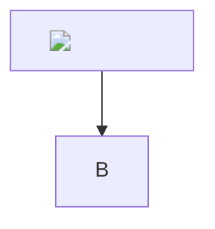

# Hostile Markdown

Plain script: <script>window.__pwned='script'</script>

Image onerror: 

Tag with attributes: <b onclick="window.__pwned='b'">bold</b> and <i style="x">i</i>

SVG: <svg onload="window.__pwned='svg'"></svg> <iframe src="javascript:window.__pwned='iframe'"></iframe>

Links: [plain](javascript:window.__pwned='link') [upper](JAVASCRIPT:window.__pwned='upper') [space]( javascript:alert(1)) [tab](java&#9;script:window.__pwned='tab') [newline](java&#10;script:window.__pwned='nl') [entity](&#106;avascript:window.__pwned='ent') [control](&#1;javascript:window.__pwned='ctl') [vb](vbscript:msgbox(1)) [data](data:text/html,<script>window.__pwned='data'</script>)

Images:   

Quote break: [x](https://a.example/"onmouseover="window.__pwned='attr') 

Code: `<script>window.__pwned='code'</script>`

Wiki: [[]]

|  | b |
| --- | --- |
| [c](javascript:window.__pwned='cell2') | d |

- [ ] <script>window.__pwned='task'</script>



Raw control: [c1](javascript:window.__pwned='c1') [c2](javascript:window.__pwned='c2') 

Embeds that aren't the edition's stay code:

```embed

```

```embed
__proto__
```
